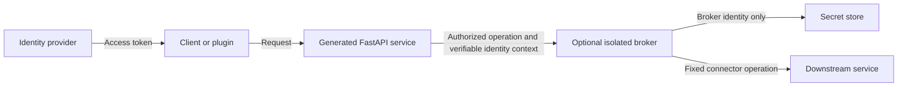

# authCore: architecture assessment and modern alternatives

Research date: 2026-10-28. This is a design assessment of the local repositories and primary-source documentation, not a penetration test or confirmation of the deployed ChRIS/CUBE authentication contract.

**Judgment:** authCore identified a worthwhile problem: application databases should not become a collection of reusable credentials for every connected system. Its proposed separation of caller identity from downstream credentials is sound. Its design overstates what an in-process Python module can isolate, and combines identity-provider duties, secrets storage, authorization, and arbitrary HTTP proxying before establishing one working, constrained integration. The useful core is a small authentication adapter plus explicit authorization and service connectors. A separately deployed broker is justified when the threat model requires keeping downstream credentials out of application processes.

The [design document](/home/rudolph/src/authCore/docs/authCore-design.adoc:25) describes authentication, encrypted credential storage, brokering, privileged administration, refresh, and auditing as provided capabilities. Several corresponding implementation files (`app/core.py`, `app/auth/jwt_handler.py`, `app/auth/password_manager.py`, `app/credentials/broker.py`, `app/credentials/storage.py`, and `app/utils/crypto.py`) are empty. Treat the document as a proposal, not evidence of implemented security properties.

The most significant conceptual issue is the claim that compromising application memory does not expose secrets held by an imported module. Ordinary Python modules share their application's process and privileges. Keeping a secret out of a function's return value reduces accidental disclosure, but it does not isolate that secret from arbitrary code execution or memory inspection in the same process. Encryption can protect a stolen database backup when the attacker lacks keys; runtime decryption in the compromised process does not provide that protection. This is an architectural inference from the proposed deployment, contradicting the [local memory-isolation claim](/home/rudolph/src/authCore/docs/authCore-design.adoc:129). Even HashiCorp Vault explicitly excludes inspection of its own running memory and host code execution from its confidentiality guarantees. A remote service moves the boundary; it does not make the service itself immune to compromise. [Vault security model](https://developer.hashicorp.com/vault/docs/internals/security)

**Modern approaches address different parts of the problem:**

| Concern | Existing approach | Appropriate role for authCore |
|---|---|---|
| Human login and institutional SSO | OIDC identity provider | Validate accepted credentials through a maintained protocol implementation and normalize identity |
| A service acting for a user | Scoped OAuth access tokens; token exchange where supported | Preserve subject, calling workload, intended audience, and authorization context |
| Unattended workloads | Platform workload identity or SPIFFE/SPIRE | Authenticate the calling service without copying user passwords into jobs |
| Static external credentials | Managed secrets service or established Vault deployment | Store references and connector metadata; request only the credential a connector needs |
| Dynamic credentials | Provider-native short-lived credentials or supported Vault secret engines | Prefer revocable, limited-duration access where the target supports it |
| Legacy systems requiring reusable secrets | Narrow operation broker | Implement the ecosystem-specific integration and enforce operation/resource policy |

OIDC standardizes user authentication on top of OAuth; this supports delegating login, rather than implementing another password database, recovery process, and MFA system inside each generated application. The recommendation is architectural: use the organization's provider, or evaluate a self-hosted provider if one is needed. OIDC does not supply your application's resource-level authorization policy. [OpenID Connect Core](https://openid.net/specs/openid-connect-core-1_0.html)

Current OAuth security guidance recommends restricting access tokens by audience and by resources/actions. It also prohibits the OAuth resource-owner password credentials grant. That prohibition should not be misrepresented as forbidding every first-party password login; the relevant lesson here is to avoid collecting a user's downstream password to recreate delegated access when an authorization flow is available. For a new interactive OAuth client, use the authorization-code flow with PKCE and a maintained implementation. [RFC 9700](https://www.rfc-editor.org/rfc/rfc9700.html)

RFC 8693 defines token exchange with target audience/resource, scope, subject identity, and optional actor identity. It offers a standard vocabulary for a plugin acting on behalf of a user. Exchange is not magic interoperability: issuers, recipients, policies, and token formats must be configured to support it. Revocation of an input token does not inherently revoke exchanged tokens; that behavior needs explicit implementation. [RFC 8693](https://www.rfc-editor.org/rfc/rfc8693.html)

Product support must also be checked precisely. Keycloak documents supported standard token exchange for internal clients, while actor-aware token-exchange delegation is currently a preview feature. Choosing “Keycloak” alone does not settle every delegation requirement. [Keycloak token exchange](https://www.keycloak.org/securing-apps/token-exchange)

SPIFFE's Workload API supports fetching short-lived JWT identities for a particular audience. This identifies a service or job; it does not by itself prove that the workload is permitted to act for a specific user on a specific resource. Keep workload identity and user delegation distinct. [SPIFFE Workload API](https://spiffe.io/docs/latest/spiffe-specs/spiffe_workload_api/)

Secrets managers solve storage, access control, lifecycle, and auditing concerns. They commonly deliver secrets to an authorized caller. For example, Vault's database engine creates leased credentials that clients use to contact the database; AWS documents retrieval/caching, rotation, and least-privilege access. Therefore, replacing MongoDB with a secret manager does not automatically meet a requirement that application processes never receive secrets. Put a separately authorized broker between the application and the secret manager if that stronger requirement matters. [Vault database secrets](https://developer.hashicorp.com/vault/docs/secrets/databases), [AWS Secrets Manager practices](https://docs.aws.amazon.com/secretsmanager/latest/userguide/best-practices.html)

**The broker must constrain authority, not merely hide a password.** The proposed [`request_broker`](/home/rudolph/src/authCore/docs/authCore-API.adoc:279) accepts a caller-supplied username; its [`BrokerRequest`](/home/rudolph/src/authCore/docs/authCore-API.adoc:550) accepts HTTP method, endpoint, parameters, body, and headers. Without an explicit relationship between the authenticated actor, credential owner, operation, and resource, a user could ask the broker to use someone else's authority or exercise all powers of a shared downstream account. This is a design risk, not a claim of an exploit in the currently empty broker implementation.

Prefer typed operations such as `files_list(connection_id, resource_id)` to a public “send this HTTP request with these credentials” interface. Resolve the connection and its owner server-side, authorize the operation before retrieving credentials, and configure the downstream origin independently of request input. Reject credential-header overrides; do not follow arbitrary redirects; limit outbound network destinations and response size. OWASP specifically supports allowlisting known destinations, application plus network controls, and disabling redirects that could bypass validation. [OWASP SSRF prevention](https://cheatsheetseries.owasp.org/cheatsheets/Server_Side_Request_Forgery_Prevention_Cheat_Sheet.html)

A broker may still return sensitive business data, and a compromised authorized client may still invoke its allowed operations. The defensible claim is a reduced credential-extraction surface and bounded authority, not elimination of the effects of application compromise. Audit events should identify the human subject, calling workload, operation, resource, and outcome without logging passwords, tokens, or entire sensitive responses.

**Suggested combined baseline:** keep `fapp_build` a small generator of runnable, tested FastAPI services, and make authCore a versioned dependency for optional authentication/connectors rather than copying security implementation into every output. Default generated projects should have health/readiness routes, validated configuration, application lifecycle management, structured redacted logging, and one tested protected route when authentication is selected. Database support and outbound-service integrations should be explicit options.

For authCore, initially implement one accepted identity source, a stable `Principal` model, an authorization decision for one real operation, one connector, and a secrets-provider interface backed by an existing store. Retire the globally shared vault-key mechanism as the default authorization scheme. Avoid automatic plaintext filesystem fallback for security state. If an institution requires isolated credential execution, run that connector behind a separate broker identity and API, with secrets permissions unavailable to the generated application. Do not make a distributed service mandatory if the actual requirement is only centralized configuration and protection against database-only disclosure.

The first acceptance case should be one actual CUBE/plugin workflow: identify the caller and the originating user; authorize access to a specified resource; execute a single downstream operation; audit attribution; reject another user's resource, wrong audience, expired token, unexpected destination, and backend unavailability. Keep authentication failures closed and ensure logs and responses omit credentials. Resolve retries and idempotency before allowing mutations.

**CUBE integration evidence and limits:** the local `/home/rudolph/src/ChRIS_ultron_backEnd` checkout is at commit `c689d0f`, dated 2025-03-12. Its [authentication configuration](/home/rudolph/src/ChRIS_ultron_backEnd/chris_backend/config/settings/common.py:71) uses Django REST Framework token, basic, and session authentication. Its [token endpoint](/home/rudolph/src/ChRIS_ultron_backEnd/chris_backend/core/api.py:21) calls DRF's `obtain_auth_token`. This is evidence about that checkout, not the current deployed CUBE contract. Do not assume OIDC discovery, OAuth introspection, audience restriction, or token exchange. The authCore API document's example validation endpoint is not proof that endpoint exists. Establish identity mapping, expiration, revocation, and plugin delegation behavior against the target deployment before choosing an adapter. Possession of a general CUBE token must not automatically grant access to unrelated systems.

**Implementation findings reinforce the design concern.** The existing [VaultAdmin persistence code](/home/rudolph/src/authCore/app/vault/admin.py:84) serializes the vault key into a database document without application-level encryption in this path. [Initialization](/home/rudolph/src/authCore/app/utils/setup.py:48) creates a document containing the configured vault key; its [filesystem fallback](/home/rudolph/src/authCore/app/utils/setup.py:117) writes documents as ordinary JSON. These mechanisms do not implement the encrypted credential store described in the design. Infrastructure-level disk encryption, if configured elsewhere, would not change that observation.

The current vault is primarily a shared administrative secret and a lock flag. It is not per-user authentication, role authorization, or an encryption-key management system. `vaultKey_set` also changes in-memory state and ignores the result of persistence. Its stored lock state and messages about resetting on restart need a coherent lifecycle contract. These are prototype behaviors, not a foundation to copy into every service.

**A concrete division of responsibilities:**

| Deliverable | Owns | Explicit exclusions from the initial version |
|---|---|---|
| `fapp_build` | Templates, project metadata, runnable FastAPI entry point, lifecycle, health/readiness, tests, Docker and CI | Copied credential vaults, LLM models, custom login system, mandatory MongoDB |
| `authcore` Python package | Trusted identity adapters, normalized principal, explicit policy checks, typed connector/client contracts | Password recovery, MFA, homegrown JWT issuance, encryption algorithms |
| Optional broker service | Independent authorization, secret access, narrowly allowed downstream operations, audit attribution | Public arbitrary HTTP proxy, credential export, user-selectable arbitrary origins |
| Existing identity provider and secrets platform | Login/session/token lifecycle and secret storage/lifecycle respectively | Application-specific resource policy, which remains explicit in the service/broker |

Keep the repositories separate initially. Use an actual `authcore` import namespace instead of installing another top-level `app` package into a generated app's environment. Generated projects depend on a versioned, tested package; they do not receive copies of the security source. Security fixes can then be distributed through dependency upgrades. Choose one identity source and one secret backend for the first deployment; interfaces should support replacement without requiring a multi-provider implementation now.

For a direct, trusted application, calling a connector in-process is an acceptable deployment choice with a limited claim: it improves consistency and reduces accidental credential propagation. For isolation from compromised plugins/application processes, deploy the connector as a broker under a separate workload identity, with separate secret-store permissions and no shared secret mounts or unrestricted host access. Merely opening another port or adding a container does not establish that boundary.

The broker verifies identity and authorization itself. A caller-supplied username or an unsigned forwarded principal is insufficient. For background jobs, keep the human subject, calling workload, job identifier, permitted operation/resource, intended recipient, and expiration distinct. A job's own identity does not establish the user's delegation. If the selected identity infrastructure cannot issue the required restricted grant, resolve that contract explicitly rather than silently forwarding an unrestricted user token.

**Security claims should be stated by threat:**

| Threat | Defensible objective | Remaining exposure |
|---|---|---|
| Application database read/backup theft | Store secret references, or ciphertext with keys outside that database | Application data and metadata can still leak |
| Compromised application/plugin process | No permission to read downstream secrets; broker restricts operations | Attacker can exercise still-valid allowed operations and see their results |
| Compromised broker process | Limit which secrets and destinations that broker can access | Secrets used by that broker can be exposed |
| Valid user attempts another user's operation | Verify tenant, subject/actor, connection ownership, action, and resource | Broad downstream service accounts require particularly narrow broker policy |

**Build the baseline in three small increments:**

1. Make the generated minimal service start and pass tests. Remove inherited vault/AI code from the default template, correct generated documentation, add a health check and one ordinary example route. Make database support optional. Authentication-selected projects must fail startup if required settings are missing; never silently fall back to anonymous access.
2. Add a protected profile using one verified identity integration. Normalize the principal with issuer and stable subject (and tenant/workload context as applicable), keep raw credentials out of the general principal model, and demonstrate one resource authorization rule. This stage can be useful without any broker.
3. If credential isolation is required, implement one separate broker workflow for one actual service. Use a fixed configured origin, typed operation, secret reference, identity binding, bounded requests/responses, and audit events. Deny operations when authentication, authorization, or required secret storage is unavailable. Use explicit development fixtures rather than automatic plaintext fallback. Add more connectors only after this workflow is demonstrated.

The acceptance suite should verify wrong issuer/audience, expiration, another user's resource, unauthorized workload/delegation, unexpected destinations/redirects, protected-header overrides, and secret backend failure. It should also verify that secrets never appear in application responses or logs. Check the documented revocation window, and ensure retries cannot duplicate non-idempotent downstream actions. These requirements are proposed work, not assertions that the current repositories already implement them.
